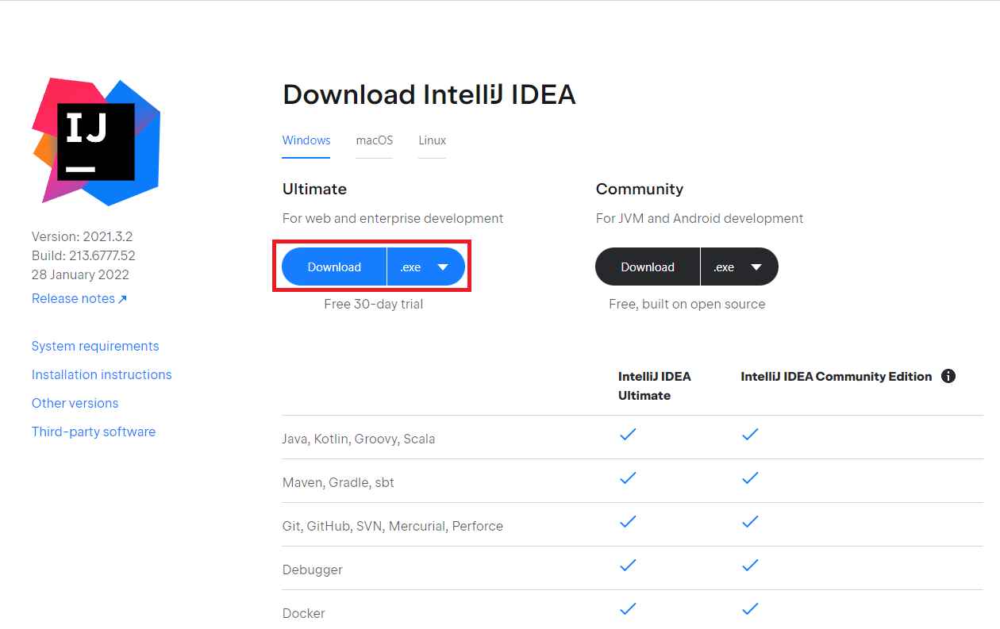
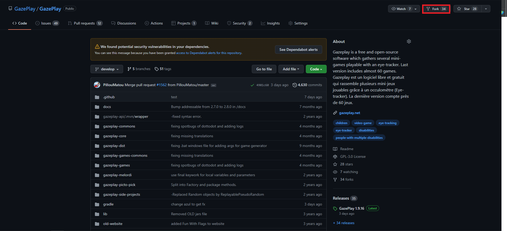
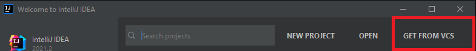
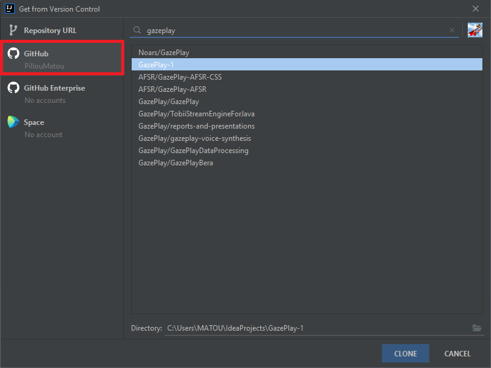
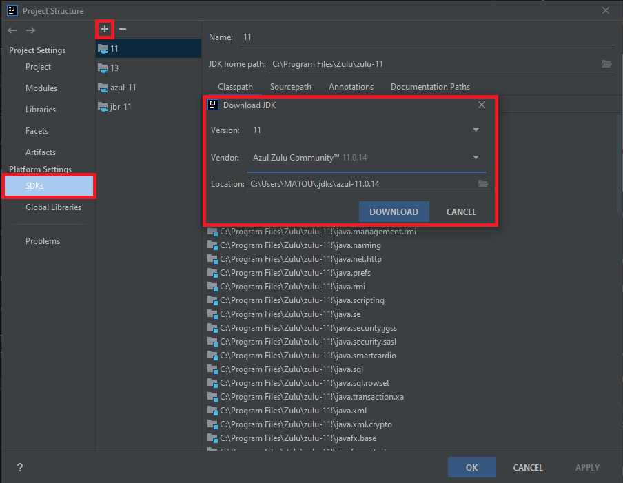
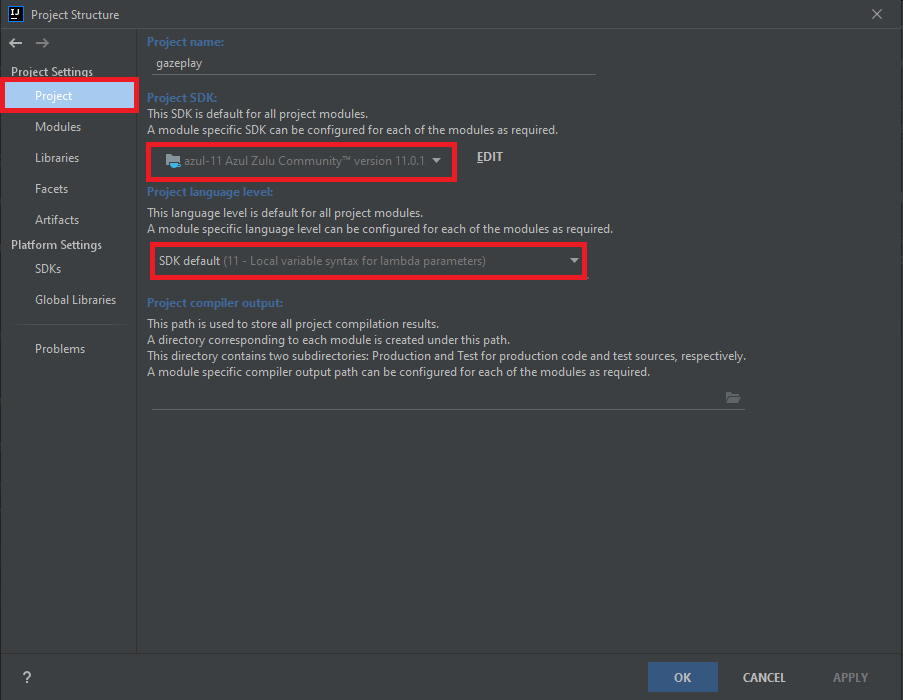
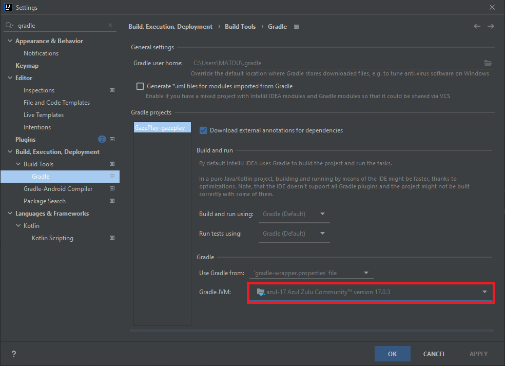
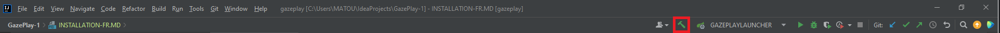
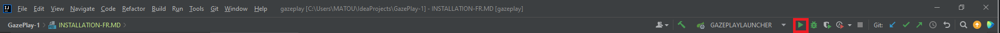

# How to install GazePlay

## Prerequisites

You must have:
* a github account.
* IntelliJ IDEA, Community (free) or Ultimate edition.

 Note :
* the github account is free.
* since October 2026 GazePlay no longer uses Spring: the free Community edition of IntelliJ is enough. More details,
  run configurations and troubleshooting (in French): [INTELLIJ.md](INTELLIJ.md).

## Step 1 : Install Intellij

The download of Intellij is here : https://www.jetbrains.com/idea/download/#section=windows

Then run the installer and follow the installation procedure

## Step 2 : Fork the project Gazeplay

To fork the project, go to the Gazeplay git repository: https://github.com/GazePlay/GazePlay
 
Then click on the fork button at the top right of the screen.

## Step 3 : get the forked project

Start Intellij, it will ask you to connect with your account (you have to create it if you don't have one).
  Once connected go to "get from vcs" select your account.

Then select the gazeplay project and clone.

## Step 4 : télécharger le SDK azul-21

In Intellij, you have to download the azul-21 SDK.
 
To do this: file -> project structure -> SDKs -> "+" -> download JDK

Make sure that the project is properly configured on the previously downloaded azul-21.
 
To do this: file -> project structure -> Project

## Step 5 : Check JDK on Gradle settings

Check if gradle use the Azul JDK 21, else change it. Also set "Build and run using" and "Run tests using" to Gradle:
the tests must always run through Gradle, which isolates them from your real GazePlay folder.

## Step 6 : Build the project

To launch the build: press the green hammer at the top right of the screen and the build will start.

## Step 7 : start the projet

Select the **GazePlay** run configuration in the list at the top right of the screen (it is provided by the project,
in the `.run/` folder; reload the Gradle project if it does not appear), then press the green arrow and gazeplay will
start. Former run configurations of type "Spring Boot" no longer work: delete them.

Try to run at least one game.

## You have completed the installation

From here you have finished the installation.

If you encounter any problems, do not hesitate to contact the team.
