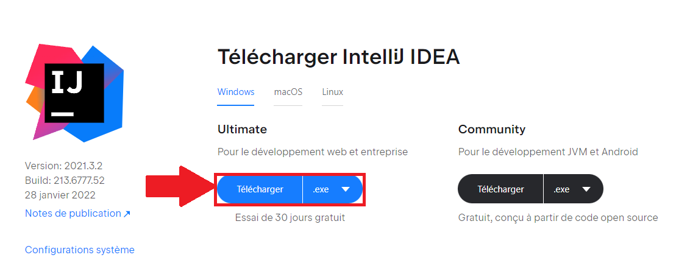

# Comment installer GazePlay

## Prérequis

Il faut avoir: 
* un compte github.
* IntelliJ IDEA, édition Community (gratuite) ou Ultimate.

 Précision : 
* le compte github est gratuit.
* depuis octobre 2026, GazePlay n'utilise plus Spring : l'édition gratuite Community d'IntelliJ suffit. Détails,
  configurations de lancement et dépannage : [INTELLIJ.md](INTELLIJ.md).

## Etape 1 : Installer Intellij

Le téléchargement d'Intellij est ici : https://www.jetbrains.com/fr-fr/idea/download/#section=windows

Puis exécuter l'installateur et suivez la procédure d'installation.

## Etape 2 : Forker le projet Gazeplay

Pour forker le projet, il faut aller sur le dépôt git Gazeplay : https://github.com/GazePlay/GazePlay
 
Puis cliquer sur le bouton fork en haut à droite de l'écran.

## Etape 3 : récupérer le projet forké

Lancer Intellij, celui-ci vous demandera de vous connecter avec votre compte (il faut le créer si vous n'en avez pas).
  Une fois connecté aller dans "get from vcs" sélectionner votre compte.

Puis sélectionner le projet gazeplay et cloner.

## Etape 4 : télécharger le SDK azul-25

Dans Intellij, il faut télécharger le SDK azul-25.
 
Pour ce faire : file -> project structure -> SDKs -> "+" -> download JDK

Assurez-vous que le projet est bien configuré sur l'azul-25 téléchargé précédemment.
  
Pour ce faire : file -> project structure -> Project

## Etape 5 : Vérifier les paramètres de Gradle

Vérifier que Gradle utilise le JDK Azul 25, sinon changer le. Régler aussi « Build and run using » et « Run tests
using » sur Gradle : les tests doivent toujours passer par Gradle, qui les isole de votre vrai dossier GazePlay.

## Etape 6 : Build le projet

Pour lancer le build : appuyer sur le marteau vert en haut à droite de l'écran et le build va se lancer.

## Etape 7 : lancer le projet

Choisir la configuration **GazePlay** dans la liste en haut à droite de l'écran (elle est fournie par le projet, dans
le dossier `.run/` ; recharger le projet Gradle si elle n'apparaît pas), puis appuyer sur la flèche verte et gazeplay va
se lancer. Les anciennes configurations de type « Spring Boot » ne fonctionnent plus : les supprimer.

Tester de lancer au moins un jeu.

## Vous avez terminer l'installation

A partir d'ici vous avez fini l'installation.

Si vous rencontrez des problèmes n'hésitez pas à contacter l'équipe.
